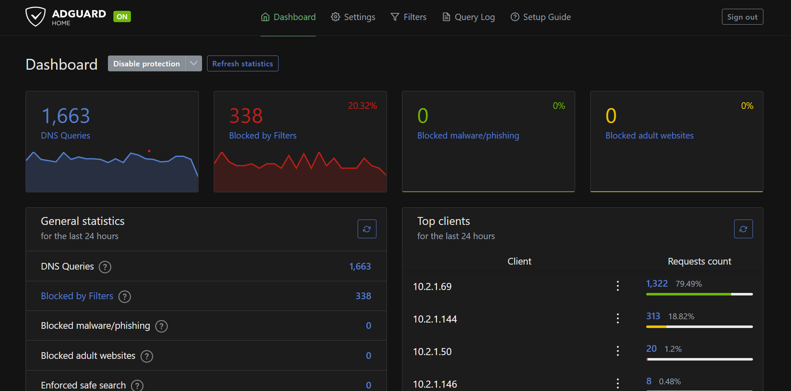
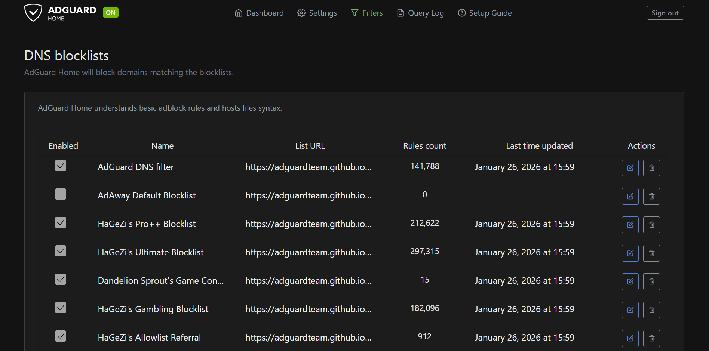

# AdGuard Home

## Overview

AdGuard Home runs as LXC 101 on Proxmox, providing DNS-level ad blocking and query logging for all VLANs.

## Configuration

| Setting | Value |
|---------|-------|
| Container ID | LXC 101 |
| IP Address | 10.2.1.x (VLAN 21) |
| DNS Port | 53 |
| Web UI Port | 3000 |

## DNS Flow

All VLANs point to AdGuard as their DNS server:
1. Client queries AdGuard (10.2.1.x)
2. AdGuard checks blocklists
3. If allowed, forwards to upstream (1.1.1.1 / 8.8.8.8)
4. Response returned to client

## Allowlist (custom rules)

The HaGeZi Ultimate blocklist is aggressive. These domains are explicitly allowed in **Filters > Custom filtering rules**:

| Rule | Why |
|---|---|
| `@@\|\|collections.md.mp.microsoft.com^` | Microsoft Store entitlement / DLC check. Blocking it made Dead by Daylight on the Xbox fail with "failed to initialize" |
| `@@\|\|userstats.xboxlive.com^` | Xbox Live user statistics, checked at game launch |
| `@@\|\|avty.xboxlive.com^` | Xbox Live activity feed |
| `@@\|\|monitor.azure.com^`, `@@\|\|opinsights.azure.com^` (plus 7 more specific `eastus.*` / `global.*` subdomains of both) | Azure Monitor / Log Analytics agent endpoints (handler, ingest, ODS, OMS). The security lab's honeypot and syslog logging ships to Azure through them and broke while they were blocked |

The query log is only written to disk every 1000 entries, so to debug a block that just happened, use the web UI's query log rather than the file.

## Why LXC Instead of Docker?

- DNS needs to be available even if Docker host is down
- Lower resource overhead than a full VM
- Isolated from other services

## Screenshots

### AdGuard Dashboard

*AdGuard Home dashboard showing DNS activity, query statistics, and overall system status.*

### DNS Blocklists Configuration

*Configured DNS blocklists used by AdGuard Home to filter ads, trackers, and malicious domains across all VLANs.*