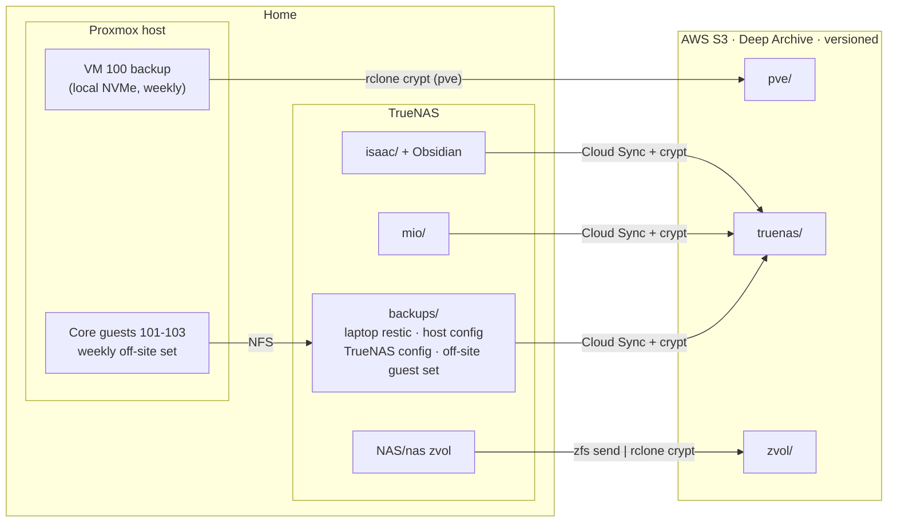

# Off-site Backups (AWS S3 Glacier Deep Archive)

## Overview

Everything worth restoring leaves the house **encrypted** and lands in one S3 bucket in Glacier Deep Archive (~$1/TB/month). The house can burn down, the NAS can be stolen, or a compromised server can try to delete its backups — the off-site copy survives all three.



## What Goes Where

| Source | Method | S3 prefix | Schedule |
|---|---|---|---|
| `datastore/isaac` (personal files, Obsidian vault) | TrueNAS Cloud Sync, from a ZFS snapshot | `truenas/isaac` | Daily 01:00 |
| `datastore/mio` | TrueNAS Cloud Sync, from a ZFS snapshot | `truenas/mio` | Daily 01:15 |
| `datastore/backups` — laptop restic repo, Proxmox host config, TrueNAS config exports, weekly off-site guest set | TrueNAS Cloud Sync (nightly guest backups excluded) | `truenas/backups` | Daily 06:00 |
| TrueNAS config (DB + secret seed) | [`truenas-config-export.sh`](truenas-config-export.sh) → `backups/truenas-config/` | via `truenas/backups` | Weekly, Sun 05:00 |
| Core guests 101–103 | Proxmox job `weekly-offsite` → `backups/proxmox/offsite/` | via `truenas/backups` | Weekly, Sun 04:00 |
| TrueNAS VM 100 | [`offsite-truenas-vm`](offsite-truenas-vm) on the Proxmox host — **not** through TrueNAS | `pve/truenas-vm` | Weekly, Sun 06:30 |
| `datastore/NAS/nas` (2TB zvol, ~1TB used) | [`zvol-offsite.sh`](zvol-offsite.sh): `zfs send` → `rclone rcat` | `zvol/` | Full every 180 days, differential monthly |

Media (`datastore/data`) is excluded: it can be re-acquired.

### Why the TrueNAS VM goes straight from Proxmox

If TrueNAS is the thing that died, restoring it can't depend on TrueNAS. The Proxmox host uploads VM 100's weekly backup itself, with its own credential.

### Why full + differential for the zvol

The zvol is a raw block device for a Windows PC, so it can't be file-synced. Every 180 days a held `@offsite-base-YYYYMMDD` snapshot is sent in full; every month after that, only the changes since that base. There is never a chain longer than one: **restore = latest full + newest diff for that full**. 180 days matches Deep Archive's minimum storage duration, so replacing a full is never billed early.

## Encryption

All data is encrypted **before upload** with rclone `crypt` (XSalsa20-Poly1305, scrypt-derived keys), including file names. One passphrase + salt is shared by all three uploaders, so a single rclone config can restore anything. The passphrase is stored in a password manager — **without it the off-site copy is unrecoverable**. S3 adds SSE-S3 encryption at rest on top.

No script stores secrets: the zvol job reads the AWS key and passphrase from the TrueNAS middleware at run time and builds its rclone config in environment variables only.

## Bucket Protections

| Control | Effect |
|---|---|
| Versioning + 180-day noncurrent expiration | Deleted or overwritten files stay recoverable for 180 days |
| Separate IAM user per uploader ([TrueNAS](aws/iam-offsite-truenas.json), [Proxmox](aws/iam-offsite-pve.json)) | Each can write only its own prefix |
| No `DeleteObjectVersion`, `ListBucketVersions`, `RestoreObject`, bucket-config permissions | A compromised server can't purge history, read archives or change the bucket |
| `zvol/` is write-only for the uploader | Old zvol streams are only removed by lifecycle (190 days) |
| Explicit deny unless storage class is `DEEP_ARCHIVE` | A leaked key can't fill the bucket with expensive storage classes |
| [Lifecycle](aws/bucket-lifecycle.json): transition to Deep Archive at day 0, abort incomplete uploads after 7 days | Catch-all for anything uploaded another way |
| [Bucket policy](aws/bucket-policy.json): deny non-TLS; Block Public Access on | No plaintext transport, never public |

## Cost Controls

| Guardrail | Threshold |
|---|---|
| Monthly budget `homelab-monthly` | $10 — email at $8 actual and $10 forecast |
| **Automatic hard block** | At **$15** actual, AWS Budgets attaches [`offsite-uploads-blocked`](aws/iam-offsite-uploads-blocked.json) (deny `s3:*` on the bucket) to both uploader users |
| Cost Anomaly Detection | Daily summary of anomalies ≥ $2 |

Expected cost: ~$1.50–2.50/month for ~1.1 TB in Deep Archive. A **full** disaster restore of everything is a one-off ~$100–150 (mostly data transfer out); single folders cost cents.

The hard block uses an IAM role that AWS Budgets assumes ([trust](aws/budgets-role-trust.json), [permissions](aws/budgets-role-permissions.json)); it may only attach/detach that one deny policy to those two users.

### Un-blocking after the hard block fires

The block does **not** lift itself. After finding out why spend jumped:

```bash
aws iam detach-user-policy --user-name offsite-truenas --policy-arn arn:aws:iam::<account>:policy/offsite/offsite-uploads-blocked
aws iam detach-user-policy --user-name offsite-pve     --policy-arn arn:aws:iam::<account>:policy/offsite/offsite-uploads-blocked
```

Then reset the action to standby in Billing → Budgets → `homelab-monthly` → Actions.

## Restore

Deep Archive objects must be **thawed** first (Bulk ≈ 48 h, Standard ≈ 12 h), using an admin identity — the uploaders can't.

```bash
# 1. Thaw a prefix (example: the TrueNAS VM backups) for 7 days, Standard tier
aws s3api list-objects-v2 --bucket <bucket> --prefix pve/ --query 'Contents[].Key' --output text | tr '\t' '\n' |
  xargs -I{} aws s3api restore-object --bucket <bucket> --key {} \
     --restore-request '{"Days":7,"GlacierJobParameters":{"Tier":"Standard"}}'

# 2. After thawing, download + decrypt with an rclone config like rclone.conf.example
rclone copy offsite:truenas-vm /var/lib/vz/dump/          # Proxmox side
rclone copy sec:isaac /restore/isaac                      # remote "sec" = crypt over s3:<bucket>/truenas/isaac

# 3. zvol: newest full, then the newest diff made from that full
rclone cat sec:full-YYYYMMDD.zfs | zfs receive datastore/NAS/nas-restored
rclone cat sec:diff-YYYYMMDD-YYYYMMDD.zfs | zfs receive datastore/NAS/nas-restored
```

## Failure Alerts

| Job | On failure |
|---|---|
| Cloud Sync tasks | TrueNAS alert → email |
| `truenas-config-export.sh`, `zvol-offsite.sh` | Email via `midclt call mail.send` (ERR trap) |
| `offsite-truenas-vm` | Prints only on error → cron mails root → Proxmox forwards to email |
| Proxmox `weekly-offsite` job | Proxmox notification (warning/error) → email |
