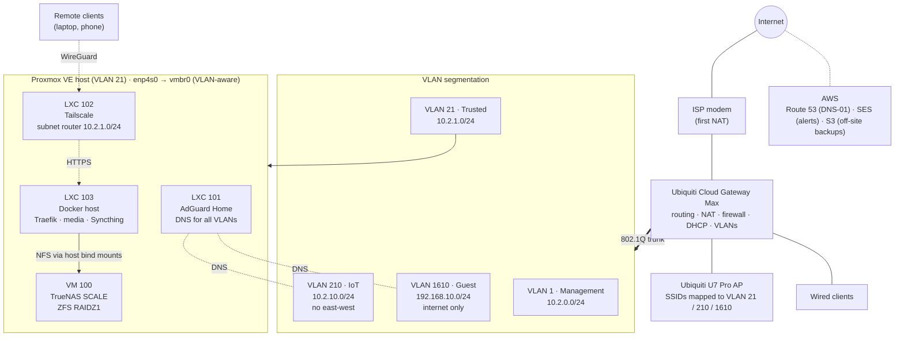
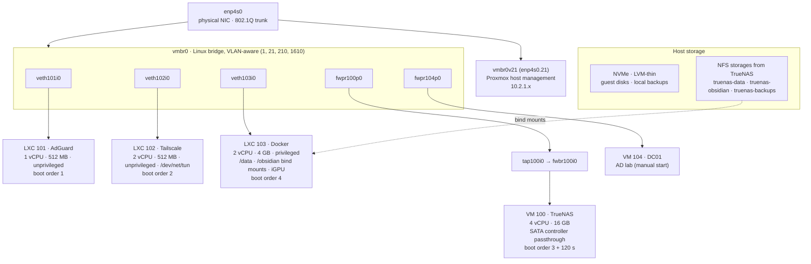
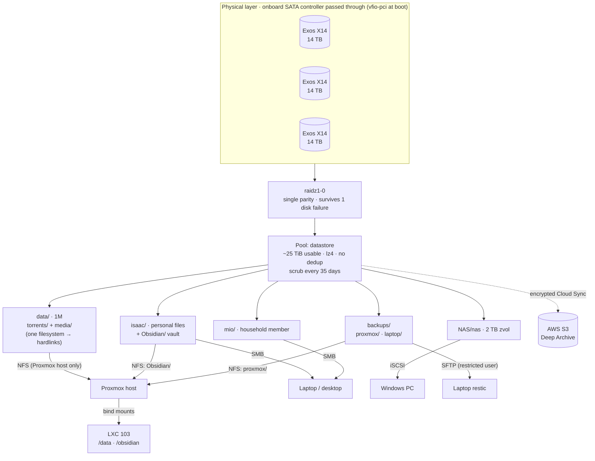
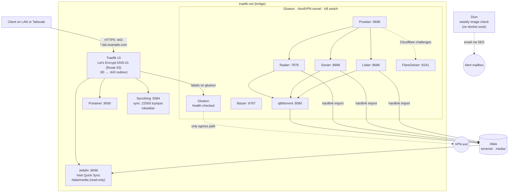

# Diagrams

Architecture diagrams for the homelab, from network topology down to individual services. They are written in [Mermaid](https://mermaid.js.org/), so GitHub and Obsidian render them directly from this file and they can be updated in the same commit as the change they describe.

---

## Network Topology (Logical View)

**Security highlights**
- No inbound port forwarding; remote access only through Tailscale
- Firewall rules between VLANs; IoT has no east-west traffic, guests are internet-only
- TLS for every internal service via Let's Encrypt DNS-01 (no ports 80/443 opened)
- Download traffic leaves only through a VPN tunnel (Gluetun)
- Double NAT (ISP modem → gateway)

---

## Proxmox Networking & Guests

| Interface | Meaning |
|---|---|
| `vethXXXi0` | LXC container veth pair |
| `tapXXXi0` | KVM VM tap device |
| `fwbrXXXi0` / `fwprXXXp0` | Proxmox firewall bridge / its port on vmbr0 |

---

## TrueNAS ZFS Storage

**Snapshot tasks:** `isaac` daily, `backups/laptop` daily, `NAS` weekly (recursive), all kept 4 weeks. Media (`data`) is not snapshotted.

---

## Docker Container Architecture (LXC 103)

**Key points**
- Only download and indexer traffic goes through the VPN; Jellyfin stays local for fast household streaming
- VPN apps share Gluetun's network namespace and start only after Gluetun is healthy
- All images pinned to exact versions; Diun reports new ones weekly
- Secrets come from `.env`; nothing sensitive is in the compose file

---

## Backup & Off-site Flow

See the diagram in [backups/offsite/README.md](../backups/offsite/README.md): Proxmox and TrueNAS upload encrypted copies to AWS S3 Glacier Deep Archive, with the TrueNAS VM backup going directly from Proxmox so it never depends on TrueNAS.

---

## Obfuscation Policy

These diagrams intentionally omit or anonymize:
- Public IP addresses
- Individual host IP addresses (shown as `10.2.1.x`)
- VPN or overlay network node identifiers
- Cloud account identifiers

CIDR ranges and VLAN IDs are included, as they are not considered sensitive for documentation purposes.
