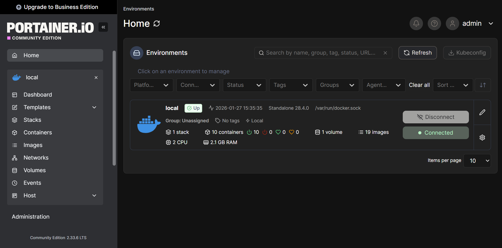
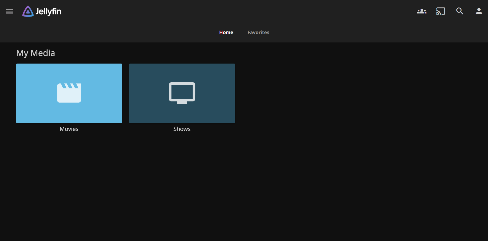

# Media Stack

## Overview

The media stack consists of the ARR suite for automated media management, qBittorrent for downloads, and Jellyfin for media streaming. All download-related traffic is routed through a Gluetun VPN container to enforce network isolation and prevent traffic leaks.

## Components

| Service      | Purpose                         | Port | Network |
|--------------|---------------------------------|------|---------|
| Gluetun      | VPN container (NordVPN, OpenVPN) | -    | traefik-net |
| Radarr       | Movie management                | 7878 | via Gluetun |
| Sonarr       | TV show management              | 8989 | via Gluetun |
| Lidarr       | Music management                | 8686 | via Gluetun |
| Prowlarr     | Indexer management              | 9696 | via Gluetun |
| Bazarr       | Subtitle management             | 6767 | via Gluetun |
| FlareSolverr | Cloudflare challenge solver for Prowlarr | 8191 | via Gluetun |
| qBittorrent  | Torrent client                  | 8080 | via Gluetun |
| Jellyfin     | Media server                    | 8096 | traefik-net (no VPN) |
| Trailarr     | Downloads trailers for Radarr/Sonarr titles | 7889 | traefik-net (no VPN) |
| Seerr        | Media requests (Jellyfin login) → Radarr/Sonarr | 5055 | traefik-net (no VPN) |

## Network Architecture

- All ARR services, FlareSolverr and qBittorrent share Gluetun's network namespace (`network_mode: service:gluetun`)
- Their web UIs are published through Traefik labels on the Gluetun container
- Jellyfin remains on the local network to provide fast, reliable streaming to household devices
- Trailarr also stays off the VPN (YouTube blocks most VPN exit IPs) and reaches Radarr/Sonarr at `http://gluetun:7878` / `http://gluetun:8989`; Seerr does the same and talks to Jellyfin at `http://jellyfin:8096`
- Gluetun kill switch prevents any outbound traffic if the VPN tunnel disconnects
- VPN apps only start once Gluetun reports healthy (`depends_on: condition: service_healthy`)

## Storage Layout

Media and downloads live on **one** TrueNAS dataset (`datastore/data`, 1M recordsize), so completed downloads are imported as **instant hardlinks** instead of slow copies:

```
/data
├── torrents/          # qBittorrent downloads, one folder per category
│   ├── movies/        #   category radarr
│   ├── tv/            #   category tv-sonarr
│   └── music/         #   category lidarr
└── media/             # Libraries the *arr apps import into (hardlinks)
    ├── movies/
    ├── tv/
    └── music/
```

| Container | Mount |
|---|---|
| Radarr, Sonarr, Lidarr, Bazarr, qBittorrent | `/data:/data` (same path everywhere, so hardlinks work) |
| Jellyfin | `/data/media:/data/media:ro` (read-only) |
| Trailarr | `/data/media:/data/media` (read-write: saves `<Title>-trailer.mkv` next to each movie/show, which Jellyfin picks up as a local trailer) |
| All apps | `/config` on the LXC's local disk (SQLite databases are kept off NFS) |

The dataset reaches the containers in two steps: TrueNAS exports it over NFS **to the Proxmox host only**, and the host bind-mounts it into LXC 103 (`mp0: /mnt/pve/truenas-data,mp=/data`). Files are written as a single non-root NAS user (`mapall`), and a guard on the empty mount point prevents writes to local disk if the NFS share is down.

## Quality Profiles

Radarr and Sonarr both have a **Best Available** profile: WEB/HDTV/Bluray at 1080p and 2160p plus Remuxes, upgrades enabled, cutoff at Remux-2160p (Sonarr: Bluray-2160p Remux). No custom formats.

Lidarr's **Best Available** accepts High Quality Lossy (MP3 V0/320, AAC-320, ...) and Lossless, upgrading until Lossless; it is the music root folder's default.

## Subtitles (Bazarr)

Language profile **English+Spanish** (en, es, es-419) is the default for movies and series. Sources need no accounts: embedded subtitles (already inside the file), Gestdown (TV), YIFY Subtitles (movies), Subtitulamos.tv and Subtis (Spanish). Podnapisi is gone from current Bazarr and TVsubtitles is forced off. OpenSubtitles.com is the best single source but needs a free account.

## Indexers (Prowlarr, public only)

| Indexer | Use | Priority | Notes |
|---|---|---|---|
| SubsPlease | Anime | 10 | |
| Nyaa.si | Anime | 15 | |
| Anime Tosho | Anime | 20 | Aggregates Nyaa, Tokyo Toshokan and others |
| Knaben | General incl. music | 25 | Meta-search over many trackers |
| The Pirate Bay | General | 25 | Via the apibay API |
| 1337x | General | 25 | FlareSolverr |
| EZTV | TV | 25 | FlareSolverr |
| Internet Archive | Public-domain content | 25 | |

Left out on purpose: YTS (heavily compressed encodes and no custom formats to filter them), LimeTorrents / Torrent Downloads / Uindex (mostly duplicates of Knaben, more fakes). Prowlarr syncs everything to Radarr, Sonarr and Lidarr (full sync); a lower priority number wins ties.

## Hardware Transcoding

The Proxmox host's Intel iGPU render node is passed into LXC 103 and then into Jellyfin (`/dev/dri`). Jellyfin uses Intel Quick Sync (QSV) for decode and HEVC encode with VPP tone mapping; an HEVC transcode uses ~20% of one CPU core.

## Lessons Learned

- **Stale VPN server list.** Gluetun's bundled NordVPN server list was over a year old and the tunnel never came up. Fix: persist `/gluetun`, run the updater once, and set `UPDATER_PERIOD=24h`.
- **Start-order race.** See [systemd/README.md](../systemd/README.md).
- **Jellyfin migration crash.** An upgrade left Jellyfin crash-looping on a database migration; the fix was a fresh config. This is one reason images are now pinned and updated deliberately.

## Screenshots

### Portainer Media Stack Overview



*Portainer dashboard showing the running media stack containers, including Gluetun, ARR services, and Jellyfin.*

### Jellyfin Dashboard



*Jellyfin web interface displaying the media libraries, used for local media streaming.*

## Disclaimer

This repository and its documentation are provided **for educational and infrastructure demonstration purposes only**.

- No guidance is provided on acquiring copyrighted material
- The author does **not** condone or support piracy
- All media management and streaming tools shown here are intended for use with **legally obtained content only**

Users are responsible for ensuring compliance with all applicable laws and service terms in their jurisdiction.
